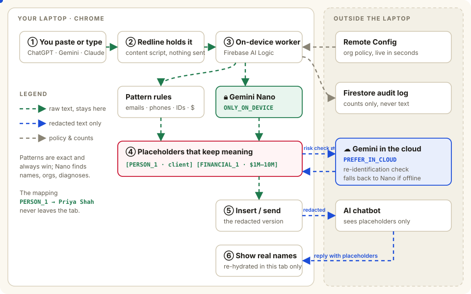

<p align="center"></p>

# Redline: a privacy firewall for AI chat

**Redline is a Chrome extension that stops confidential details from leaking into ChatGPT, Gemini, Claude, Copilot and Perplexity.** When you paste or type a message, Gemini Nano on your own laptop finds the names, case numbers, contacts, diagnoses and account numbers in it, and swaps them for placeholders *before anything leaves the device*. The chatbot still gets enough meaning to help (`[ORG_1 · hospital]`, `[FINANCIAL_1 · $1M–10M]`), and Redline puts the real values back into the reply, locally.

Built for **#BuildHybridAI 2026** with the **Firebase AI Logic hybrid inference SDK** (Web/Chrome track).

- **Try it without installing anything:** https://redline-hybrid.web.app
- **Install the extension:** [docs/JUDGES.md](docs/JUDGES.md) (about 2 minutes)
- **Product spec:** [PRD.md](PRD.md) · **Setup from source:** [docs/SETUP.md](docs/SETUP.md)

---

## The problem

Lawyers, clinicians, HR teams and consultants paste client emails, case notes and contracts into AI chatbots every day. Each paste can break attorney–client privilege, health-privacy rules or an NDA. Today's options all fall short:

- **Banning AI tools** doesn't work; people use them anyway.
- **Cloud data-loss-prevention services** have to see the secret in order to find it, which moves the leak instead of stopping it.
- **Keyword and regex filters** catch emails and card numbers, but miss *"our client Priya Shah"*, *"the only female partner in our Austin office"* or *"stage 3 chronic kidney disease"*.

## Why hybrid on-device + cloud

| Concern | Cloud only | On-device only | **Redline (hybrid)** |
|---|---|---|---|
| Raw secret leaves the laptop | ❌ yes, to be scanned | ✅ no | ✅ **never**, enforced in code |
| Latency on every paste and message | ❌ a network round trip | ✅ local | ✅ local, with a background check while you type |
| Cost at "every message, every employee" scale | ❌ per call | ✅ free | ✅ every redaction is local; the cloud is only used for the optional risk check |
| Subtle re-identification reasoning | ✅ | ⚠️ limited | ✅ cloud reviews **already-redacted** text only |
| Laptop without Gemini Nano | ✅ | ❌ | ✅ pattern detectors plus a clear "reduced protection" notice |

**The routing rule:** raw text goes **only** to Gemini Nano (`InferenceMode.ONLY_ON_DEVICE`). Redacted text may go to the cloud (`PREFER_IN_CLOUD`) for a re-identification risk check. If the cloud is unavailable, the Firebase SDK automatically falls back to Gemini Nano, and the card says so.

## How it works

<p align="center"></p>

1. **Catch:** Redline intercepts large pastes, and typed messages on Enter or Send, on supported AI chat sites. A small chip on the chat box shows its status while you type.
2. **Redact on-device:** fixed patterns catch anything with a precise format (emails, phones, IDs, cards, IBANs, amounts). Gemini Nano finds what patterns can't: people, organisations, addresses, conditions, medications, codenames. Deterministic sanity rules then reject implausible labels from Nano.
3. **Keep the meaning:** placeholders carry safe hints (`[MEDICAL_CONDITION_1 · blood cancer]`, `[DATE_OF_BIRTH_1 · born 1960s]`), so the chatbot can still help. A hint is thrown away if it repeats any word of the original.
4. **Stay quiet when it's harmless:** everyday questions (money, a company, a city) go through untouched. The card appears only when something actually identifies someone.
5. **Check re-identification:** an optional check sends the *redacted* text to Gemini in the cloud. It catches things like *"the only female partner in our Austin office"*, which identifies someone without naming them.
6. **Re-hydrate locally:** **Show real names** swaps the placeholders in the AI's reply back to real values, in your tab only.

## Where Firebase is used

| Firebase product | What Redline uses it for | Code |
|---|---|---|
| **AI Logic: hybrid inference** | Gemini Nano entity extraction (`ONLY_ON_DEVICE`), plus the cloud re-identification check with automatic on-device fallback (`PREFER_IN_CLOUD`) | [`packages/core/src/ai.ts`](packages/core/src/ai.ts) (`createModels`, `extractEntitiesOnDevice`, `checkReidRisk`) |
| **App Check** | Protects AI Logic and Firestore: reCAPTCHA Enterprise on the web app, a debug token in the extension | [`packages/core/src/firebase.ts`](packages/core/src/firebase.ts) |
| **Remote Config** | The organisation's redaction policy, delivered live with real-time updates (strictness, entity types, quiet mode, keep-meaning, allow override…) | [`packages/core/src/policy.ts`](packages/core/src/policy.ts), `watchPolicy` |
| **Firestore** | A privacy-safe audit log: counts and categories only. The rules reject any field that could carry text (tested against the emulator) | [`firestore.rules`](firestore.rules), [`tests/firestore.rules.test.ts`](tests/firestore.rules.test.ts) |
| **Authentication** | Anonymous sign-in for the extension; Google sign-in for the admin console | [`packages/ui/src/AdminPage.tsx`](packages/ui/src/AdminPage.tsx) |
| **Hosting** | Playground, admin console, accuracy eval and mock chat | [`firebase.json`](firebase.json) |

## Privacy guarantees, enforced in code

- **Raw text never reaches the cloud.** The extraction model is pinned to `ONLY_ON_DEVICE`, and a response that reports any other source is rejected. Before any cloud call, `assertNoLeak` checks the payload against every original value and refuses to send.
- **The placeholder-to-value mapping stays in the tab's memory.** It never goes to storage, Firestore or the cloud.
- **The audit log can't hold content.** Every Firestore field must be a number, a boolean, a fixed value or a hostname. The rules tests show that text smuggled into a count, or an extra `text` field, is rejected.
- **Fail-safe.** If anything goes wrong (worker timeout, a stale tab after an update), the paste or message is blocked and nothing is inserted or sent.

## Accuracy

Measured with the built-in eval: 30 labelled legal, medical and HR samples, 137 sensitive spans. Run it on your own device at https://redline-hybrid.web.app/eval.

| | Recall (share of sensitive spans removed) | Median latency |
|---|---|---|
| Pattern detectors only | 35.8% | instant |
| Patterns + Gemini Nano (3 runs) | **95.6% · 97.1% · 99.3%** | ~5.5 s |

Measured on Gemini Nano v3 (`nano_v3_gpu_low_tier_model`). Redline doesn't bundle or choose a model: Chrome provides whichever Gemini Nano version the device has, and newer Nano 4 / Gemma 4-based models are picked up automatically.

## Repository layout

```
packages/core     redaction pipeline, patterns, placeholders, Firebase AI Logic calls, policy, eval set (+ unit tests)
packages/ui       shared React UI: Playground, accuracy eval, admin console
apps/extension    Chrome MV3 extension: content script, offscreen Nano worker, side panel
apps/web          hosted pages (Firebase Hosting)
tests             Firestore security-rules tests (emulator)
docs              setup guide, judges' guide, Devpost text, demo script
```

## Run it

```powershell
npm install
npm run dev:web        # Playground at http://localhost:5173
npm run build          # web app + extension (apps/extension/dist)
npm test               # unit tests
npm run test:rules     # Firestore rules against the emulator
```

Full setup (Firebase project, App Check, Remote Config keys, Chrome requirements): [docs/SETUP.md](docs/SETUP.md).

## License

[Apache-2.0](LICENSE)
