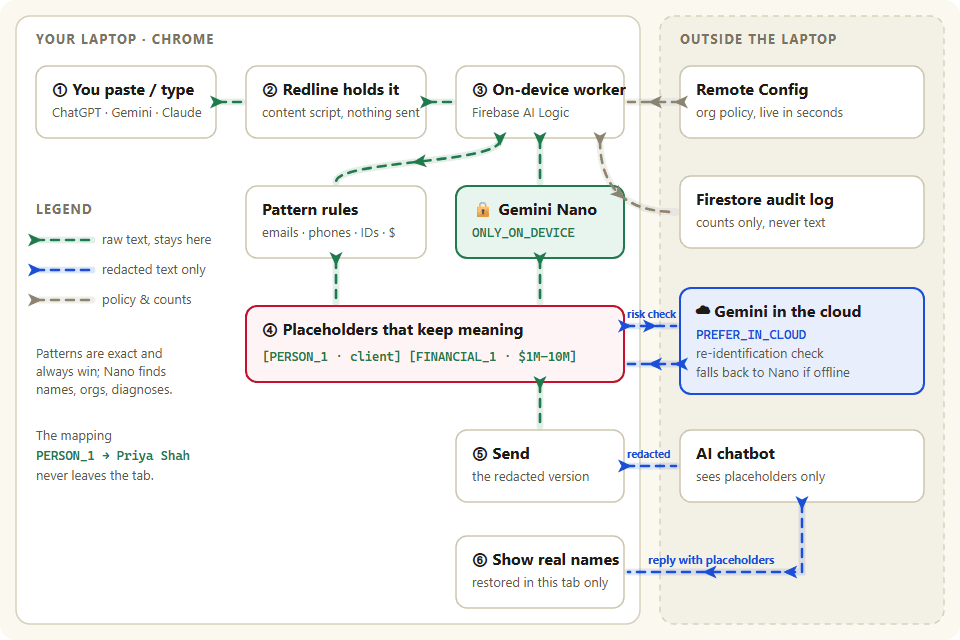

# Devpost submission: copy into each field

## Page: Project details

### About the project (paste everything inside the box below)

````markdown


## Inspiration
Every day, lawyers paste client emails into ChatGPT, clinicians paste referral letters, and HR teams paste termination notes. One paste can break attorney–client privilege, health-privacy rules or an NDA, and banning AI tools just pushes people onto personal devices. Existing fixes contain a contradiction: cloud data-loss-prevention services have to **see** the secret in order to find it. We wanted protection that runs *before* anything leaves the laptop. That's exactly what on-device AI makes possible.

## What it does
**Redline** is a Chrome extension that sits between you and AI chatbots (ChatGPT, Gemini, Claude, Copilot, Perplexity).

- **Catches pastes and typed messages.** A small chip on the chat box shows Redline is on and checks the message in the background while you type.
- **Redacts on-device with Gemini Nano.** Names, case and patient numbers, contacts, addresses, diagnoses, medications, account numbers and project codenames are replaced *before* anything is sent.
- **Keeps the meaning.** Placeholders carry safe hints, such as `[ORG_1 · hospital]`, `[FINANCIAL_1 · $1M–10M]` or `[DATE_OF_BIRTH_1 · born 1960s]`, so the chatbot's answer stays useful.
- **Stays quiet for everyday questions.** If nothing identifies anyone, the message goes through untouched.
- **Checks re-identification safely.** Only the **redacted** text goes to Gemini in the cloud, which catches clues like *"the only female partner in our Austin office"*. If the cloud is unavailable, the SDK falls back to Nano automatically, and the card says where it ran.
- **Restores real names locally.** *Show real names* swaps the placeholders in the AI's reply back to real values, in your tab only.
- **Gives organisations control.** Admins set policy live through Remote Config and see a privacy-safe audit log (counts only, never content).

## How we built it
- **Firebase AI Logic hybrid inference** is the core:
  - entity extraction runs with `InferenceMode.ONLY_ON_DEVICE`, so raw text can only ever reach Gemini Nano;
  - the re-identification check uses `PREFER_IN_CLOUD`, with the SDK's automatic on-device fallback;
  - each response's `inferenceSource` drives the 🔒 / ☁ labels, so the routing shown is what actually happened.
- **The privacy invariant is enforced in code.** `assertNoLeak` checks every cloud payload against the original values and refuses to send. Extraction rejects any response that didn't run on-device.
- **Hybrid inside the device, too.** Deterministic patterns (emails, phones, IDs, IBANs, amounts) run first and are authoritative. Nano finds what patterns can't. Sanity rules reject implausible Nano labels, and Nano is pinned to deterministic decoding inside the extension.
- **MV3 architecture.** A ~31 KB content script on chat sites (no Firebase in it) talks over an internal port to an offscreen worker that hosts Firebase and Gemini Nano.
- **Remote Config** delivers the organisation's policy live: strictness, entity types, quiet mode, keep-meaning, allow override.
- **Firestore** holds the audit log. Its security rules make storing text impossible, verified by emulator tests that try to smuggle text in.
- **App Check** (reCAPTCHA Enterprise on the web, a debug token in the extension), **Authentication** (anonymous for the extension, Google for admins) and **Hosting** (Playground, admin console, eval, mock chat).
- TypeScript monorepo, React, Vite. 46 unit tests plus 9 security-rules tests.

## Challenges we ran into
- **Making a small on-device model trustworthy.** Nano's labels varied from run to run, and it sometimes mislabelled short words ("no" as a medical condition, "10k" as a person). We built a labelled eval of 30 samples and 137 spans and fixed every failure class it revealed, with rules Nano can't override.
- **Hung on-device calls.** A timed-out Nano call kept running and blocked everything queued behind it. We found that the SDK passes `promptOptions` by reference to Chrome's `session.prompt()`, so we attached a real `AbortSignal` per call and queued on-device work.
- **Keeping meaning without leaking.** Bare placeholders make answers worse, but a hint must never echo the original ("Mary's hospital" for "St. Mary's Hospital"), so every hint is checked against the value it replaces.
- **Writing into other sites' editors** (ProseMirror, Quill) without breaking them. Redline re-dispatches the site's own paste event.

## Accomplishments that we're proud of
- **35.8% → 95.6–99.3% recall**: pattern rules alone versus rules plus on-device Gemini Nano, over three runs, with a ~5.5 s median and nothing leaving the laptop.
- Real hybrid routing, visible in the product: when the cloud call failed, the SDK fell back to Nano and the card said so honestly.
- An audit log whose security rules are tested against attempts to sneak text in.

## What we learned
On-device AI is at its best as one layer of a system: fast, private and free, but bounded by deterministic rules and measured with a real eval. Hybrid inference isn't only "offline fallback". The most useful split was **raw data stays local; abstracted data may go to the cloud**.

## What's next
- File and PDF uploads; Google Docs and Gmail compose.
- Per-industry policy presets (legal, healthcare, HR) and enterprise rollout through Chrome policy.
- Android: the same core on Firebase AI Logic's on-device inference for Android.
````

### Built with (add one tag at a time)
```
firebase-ai-logic
gemini-nano
gemini
firebase
firebase-app-check
firebase-remote-config
cloud-firestore
firebase-authentication
firebase-hosting
chrome-extension
chrome-prompt-api
typescript
react
vite
vitest
```

### "Try it out" links
- https://redline-hybrid.web.app
- https://github.com/jithendra-10/redline
- https://github.com/jithendra-10/redline/blob/main/docs/JUDGES.md

### Image gallery (3:2 ratio, PNG or JPG, ≤ 5 MB)
Upload in this order (files in `docs/media/`):
1. `01-gemini-card.jpg`: the Redline card on Gemini, redacted on-device
2. `02b-gemini-reply-real-names.jpg`: Gemini's reply with real names restored locally
3. `03c-chatgpt-card-medical.jpg`: a medical referral redacted on ChatGPT
4. `04-typing-chip.jpg`: live check while typing
5. `05-risk-check.jpg`: re-identification check (redacted text only)
6. `08-side-panel.jpg`: the side panel
7. `09-admin-console.jpg`: admin console (Remote Config policy + counts-only audit log)
8. `07-playground.jpg`: the web playground with a live trace
9. `architecture.gif`: how it works (animated workflow; the README uses the animated SVG)

### Demo video URL
`https://www.youtube.com/watch?v=…` (public or unlisted)

---

## Page: Additional info

| Field | Answer |
|---|---|
| Submitter type | Individual |
| Country of residence | India |
| Organization name | *(leave blank)* |
| Start date (MM-DD-YY) | 11-25-26 |
| New or existed before Nov 11, 2026? | New: built entirely during the submission period. |
| Platform(s) | Web (Chrome) |
| License URL | https://github.com/jithendra-10/redline/blob/main/LICENSE |
| Age / jurisdiction / not an employee checkboxes | Tick these yourself, only if true. |

### Explain how your project meets the main technology requirement
```
Redline's AI runs on the Firebase AI Logic hybrid inference SDK (firebase/ai), imported and called at runtime in packages/core/src/ai.ts:

• On-device: entity extraction uses getGenerativeModel(ai, { mode: InferenceMode.ONLY_ON_DEVICE, onDeviceParams: … }). Raw pasted or typed text is only ever processed by Gemini Nano in Chrome; the code rejects any response whose inferenceSource isn't ON_DEVICE.
• Hybrid routing: the re-identification check uses InferenceMode.PREFER_IN_CLOUD with inCloudParams (Gemini) and onDeviceParams (Nano), so it runs in the cloud when available and falls back to Nano automatically. Only already-redacted text is sent; assertNoLeak blocks any payload containing an original value.
• The UI shows where each step ran (🔒 on-device / ☁ cloud) from the SDK's inferenceSource.

App Check is required and enabled: reCAPTCHA Enterprise for the hosted web app and a registered debug token for the Chrome extension. We also use Remote Config (live org policy with real-time updates), Firestore (privacy-safe audit log whose rules reject any text, tested on the emulator), Authentication (anonymous for the extension, Google for admins) and Hosting.
```

### URL to a working demo
```
https://redline-hybrid.web.app
```

### Testing instructions
```
Full guide: https://github.com/jithendra-10/redline/blob/main/docs/JUDGES.md

Extension (main product, ~2 min):
1. Download redline-extension-1.0.0.zip from https://github.com/jithendra-10/redline/releases and unzip it.
2. chrome://extensions → Developer mode → Load unpacked → select the unzipped folder.
3. Open gemini.google.com or chatgpt.com (reload the tab if it was open) and paste the sample text from JUDGES.md. The Redline card redacts it on-device; press Enter to insert. Click "Show real names" (top right) after the reply arrives.
4. Type an everyday question: the chip shows "Nothing sensitive" and it sends normally.

Requires desktop Chrome 138+. On-device AI needs Gemini Nano (chrome://on-device-internals → prompt_api = Available); without it, Redline uses pattern detection and says so.
No AI account? Use https://redline-hybrid.web.app/mock-chat. No install: https://redline-hybrid.web.app (Playground) and /eval (accuracy eval).
No login is needed for the extension or the Playground. The admin console (/admin) needs an admin account and is shown in the video.
```
